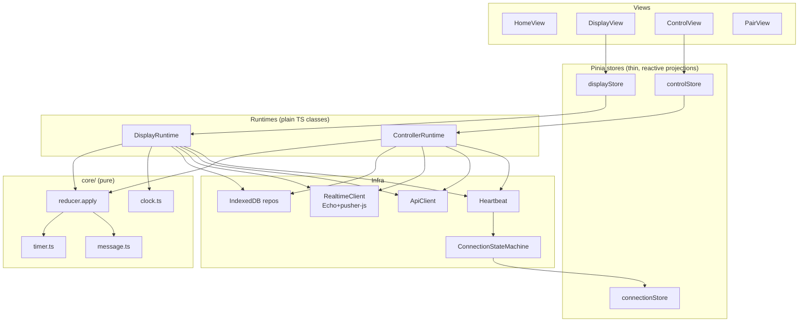
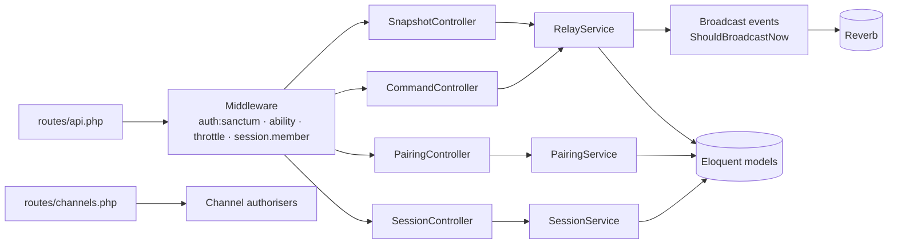
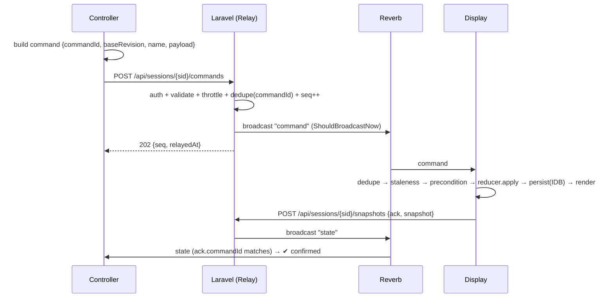
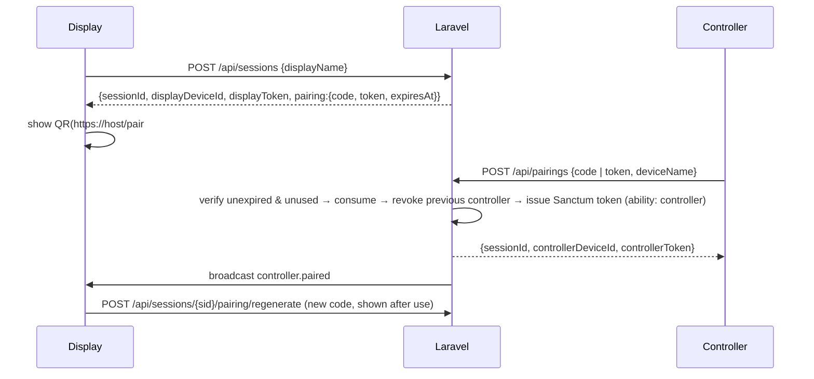
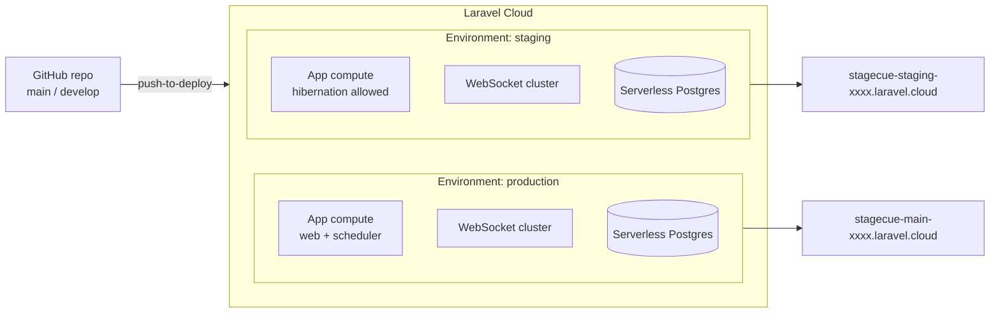

# 02 — High-Level Design (HLD)

## 1. System architecture

```mermaid
flowchart LR
  subgraph Venue
    TV[(TV / Projector)]
    subgraph Laptop["Laptop (Chrome/Edge) — DISPLAY (authoritative)"]
      DUI[Stage renderer]
      CORE[Core engine<br/>timer · message · reducer]
      IDB[(IndexedDB)]
      SW1[Service Worker<br/>app-shell cache]
    end
    subgraph Phone["Phone (PWA) — CONTROLLER"]
      CUI[Control panel + Preview]
      CCORE[Core engine<br/>(preview only)]
      IDB2[(IndexedDB<br/>credentials, drafts)]
      SW2[Service Worker]
    end
  end
  subgraph Cloud["Laravel Cloud"]
    APP[Laravel app<br/>API · broadcast auth · SPA shell]
    WS[Managed WebSockets<br/>(Reverb)]
    DB[(Serverless Postgres)]
  end
  Laptop -- HDMI --> TV
  CUI -- "HTTPS POST /commands" --> APP
  APP -- "broadcast command" --> WS
  WS -- "private-session.{id}.display" --> CORE
  CORE -- "HTTPS POST /snapshots (ack+state)" --> APP
  APP -- "broadcast state" --> WS
  WS -- "private-session.{id}.controllers" --> CUI
  CORE <-. "whisper heartbeat (presence-session.{id})" .-> CUI
  APP --- DB
  CORE --- IDB
  DUI --- CORE
```

**Key property:** the dashed and solid network edges can all fail. `CORE → DUI → TV` stays inside the laptop and has no network dependency.

## 2. Application architecture

There is one Laravel 12/13 application (a modular monolith) with three bounded modules, plus a Vue SPA that ships from the same repository.

| Module | Side | Responsibility |
|---|---|---|
| `Sessions` | Back end | Create and resume presentation sessions, lifecycle, expiry, pruning |
| `Pairing` | Back end | Pairing codes/tokens, controller device issuance, revocation |
| `Relay` | Back end | Command intake (validate, authorise, rate-limit, de-duplicate, sequence) → broadcast. Snapshot intake → broadcast + cache last snapshot |
| `core` | Front end | Pure TS: timer engine, message engine, presentation reducer, formatting, clock abstraction |
| `display` | Front end | Display runtime: tick loop, persistence, command intake, publishing, stage UI, fullscreen, wake lock |
| `control` | Front end | Controller runtime: command outbox, ack tracking, mirror, preview, drafts |
| `transport` | Front end | Echo/Reverb client, API client, heartbeat, connection state machine |
| `storage` | Front end | IndexedDB repositories |
| `shared/ui` | Front end | `Stage` component (used by the Display **and** the Preview), design tokens |

Dependency rule: `core` imports nothing else from the app. `display` and `control` depend on `core`, `transport` and `storage`. `transport` and `storage` never import `core` logic. Only the shared types live in `core/types`.

## 3. Front-end architecture



- **Runtimes own the behaviour. Stores only mirror it.** Pinia stores expose the readonly reactive state that the runtimes push. Vue components never call the reducer directly, with one exception: Preview calls it on a clone.
- **Rendering cost:** the tick loop updates one `shallowRef<number>` (`nowMono`) per second. The `Stage` derives the display strings through `computed`, so only the text nodes for the digits change.
- **TypeScript:** yes. The value is high here: the event contracts, the discriminated unions for the timer/message states, and the reducer exhaustiveness checks (`never`) catch most sync bugs at compile time. Runtime validation of incoming messages uses `zod` schemas derived from the same types.

## 4. Back-end architecture



- **Stateless API** with Sanctum bearer tokens (`Device` is the tokenable model). No cookies, no CSRF on the API.
- **`ShouldBroadcastNow`** for every real-time event, with no queue hop, to meet the < 500 ms latency target. No queue worker is needed for the MVP.
- **Scheduler** (`sessions:prune`) runs daily on Laravel Cloud's scheduler.
- **The backend is not in the loop for presentation logic.** It never interprets the timer state. It relays, authorises and keeps the last snapshot (for a quick first paint on the Controller).

## 5. Desktop ↔ mobile communication architecture

### 5.1 Channels
| Channel | Type | Members | Carries |
|---|---|---|---|
| `private-session.{sid}.display` | private | the display device only | `command` (server → Display), `controller.paired`, `controller.revoked` |
| `private-session.{sid}.controllers` | private | controller devices (and the Display, for diagnostics) | `state` (snapshot, which carries the ack), `display.status` |
| `presence-session.{sid}` | presence | the Display + controllers | `client-heartbeat` whispers, membership join/leave |

### 5.2 Command round trip



If the Controller receives no ack within **3 s**, the button shows "Not confirmed — Retry". A retry sends the **same `commandId`**, so the Display applies the command at most once.

## 6. Timer engine architecture

- The pure functions in `core/timer.ts` work on an immutable `TimerState` discriminated union (`idle | ready | running | paused | overtime`).
- `running` and `overtime` store `endsAtWall` (epoch ms) as the persisted truth. The runtime keeps a **monotonic anchor** (`endsAtMono = performance.now() + (endsAtWall - Date.now())` at the moment the command is applied) for in-session precision.
- Remaining time is derived as `remaining = endsAt - now`. A negative value is overtime. Nothing ever decrements.
- The transition from `running` to `overtime` is an explicit internal event (`TIMER_EXPIRED`) that the tick loop raises when `remaining ≤ 0` is first seen. It is persisted and published.
- The clock is injected (`Clock { wallNow(): number; monoNow(): number }`), which makes it deterministic under test.

## 7. Message engine architecture

- In `core/message.ts`: `MessageState = { status: 'none' } | { status: 'showing', id, text, mode: 'timed'|'persistent', durationMs, shownAtWall, expiresAtWall|null, corner }`.
- Expiry is computed from `expiresAtWall` with the same monotonic anchoring as the timer. The tick loop raises `MESSAGE_EXPIRED`.
- It is fully independent of the timer. The reducer composes the two (for example, the A2 overtime interaction rule lives in the reducer and nowhere else).

## 8. Presentation state & render priority

```
PresentationState {
  schema: 1
  presentationId: ULID      // epoch; new on "New presentation"
  revision: int             // +1 on every applied command or internal event
  display: { blackout: boolean }
  timer:   TimerState
  message: MessageState
  settings:{ defaultCorner, overtimeInterruptsMessage, defaultMessageDurationMs }
  updatedAtWall: number
}
```

The view is derived by the pure `deriveView(state, now)`:
1. `blackout` → **Black**
2. `message.showing` → **Message** + compact timer (or no timer if the timer is `idle`). The compact timer shows red styling if it is in overtime.
3. `timer.overtime`, or `paused` with remaining < 0 → **TIME UP**
4. `timer.ready | running | paused` → **Timer (full)**
5. `timer.idle` → **Standby** (black)

## 9. Offline-first architecture

| Layer | Offline behaviour |
|---|---|
| App shell | The service worker precaches the JS/CSS/fonts/icons. Navigations are network-first (3 s timeout) and fall back to the cached shell `/__shell`. |
| Presentation | 100% local: tick loop + reducer + IndexedDB. The network is optional. |
| Commands (Display) | Received only while online. Missed commands are **not** replayed (Pusher protocol has no history). The Controller sees the missing ack. |
| Snapshots (Display → server) | If a POST fails, keep only the **latest** snapshot in memory and flush it on reconnect (latest-wins, no queue of stale states). |
| Controller | Shows Disconnected and turns sends into drafts. It never auto-replays. |

**Recovery cases**

| Event | What survives | Result |
|---|---|---|
| WebSocket drop / internet loss | Everything (in-memory) | The presentation continues. Reconnection is automatic. |
| Tab suspended / laptop lid closed briefly | Memory may be frozen | On resume, reconcile the clocks (LLD §5.2) and re-render within 1 s. |
| Page reload / tab crash | IndexedDB | Rehydrate. The timer is recomputed from `endsAtWall`. The message expires if its `expiresAtWall` has passed. Blackout is restored. |
| Browser / OS restart | IndexedDB (not in private mode) | Same as reload. Overtime has kept accumulating in wall time. The device token is kept, so the Display rejoins the same session. |
| System clock changed while closed | — | **Limitation:** the result follows the new wall clock (no monotonic reference survives a restart). Documented. |
| Storage cleared / private window | Nothing | A fresh session. Documented. |

## 10. Local persistence strategy

IndexedDB database `stagecue`, version 1, accessed with `idb`. Stores:
- `presentation` (key `current`): the full `PresentationState` (Display only).
- `processedCommands` (key `commandId`): a ring of the last 500 ids with `appliedAt` and `result`.
- `device` (key `self`): `{ role, deviceId, sessionId, token, name }`.
- `drafts` (Controller): pending messages and timer configurations.
- `meta`: `serverTimeOffsetMs`, `lastSeq`, install flags.

Write policy: one `readwrite` transaction covers `presentation` and `processedCommands` together, so the state and the dedupe record commit atomically. Writes happen on every applied command and internal event. They never happen on ticks.

## 11. State synchronisation strategy

- **Desktop authoritative.** The only state that crosses the network from the Display is the snapshot. Controllers send only intents.
- **Revisions:** the Display's `revision` increases monotonically within a `presentationId`. A Controller ignores any snapshot whose `(presentationId, revision)` is not newer than the one it holds.
- **Sequence:** the server assigns `seq` per session (an atomic increment). It is used to detect gaps and order commands, not to authorise them.
- **Idempotency:** `commandId` (UUIDv7) has a unique index on the server (`session_commands`), and the Display persists its own dedupe set.
- **Staleness:** see Ambiguity A6.
- **Reconnect handshake:** the Controller (1) reconnects the socket, (2) is authorised on its channels, (3) `GET /state` to paint the cached snapshot marked *unconfirmed*, (4) sends a `SYNC_REQUEST` command, (5) the Display publishes a fresh snapshot, (6) the Controller applies it → **Connected**.

## 12. Device pairing & security architecture



- Tokens: Sanctum personal access tokens (SHA-256 hashed at rest), abilities `display` / `controller`, scoped to one session through `devices.session_id`.
- The pairing token sits in the URL **fragment**, so it never reaches the server logs. The PairView posts it in the body.
- Codes come from a 31-character alphabet (`23456789ABCDEFGHJKMNPQRSTUVWXYZ`), 6 characters → ~887M combinations. The limit is 5 attempts per IP per minute and 20 failed attempts per session before the code is rotated.
- Channel authorisation checks `device.session_id == {sid}`, `role` and `revoked_at IS NULL`.
- HTTPS is enforced (Laravel Cloud TLS + `URL::forceScheme('https')` + HSTS).

## 13. Deployment architecture



Details are in 06-Deployment.

## 14. Technology choices & justification

| Concern | Choice | Why |
|---|---|---|
| Back end | Laravel 12+ (PHP 8.4) | Required. First-class on Laravel Cloud. Sanctum and broadcasting are built in. |
| Real-time | Laravel Reverb via **Laravel Cloud managed WebSockets** | Pusher-protocol compatible. Echo support. No server to run ourselves. |
| Front end | Vue 3.5 + TypeScript + Vite | Required. Composition API suits the runtime/store split. |
| Routing | vue-router 4 (SPA) | Works offline from the cached shell. Inertia would tie navigation to the server. |
| State | Pinia | Standard for Vue. Used only as thin projections. |
| Styling | Tailwind CSS v4 | Required. Design tokens as CSS variables (they also prepare for branding later). |
| Local DB | IndexedDB via `idb` | Durable, async, transactional. Survives restarts. |
| PWA | `vite-plugin-pwa` (injectManifest, Workbox) | A custom SW lets us add the shell-caching rules. |
| Validation (FE) | `zod` | Runtime checks on incoming WebSocket payloads. |
| QR | `qrcode` (generate), `qr-scanner` (scan, using BarcodeDetector where it exists) | iOS Safari has no BarcodeDetector. |
| IDs | `uuid` v7 (commands), ULID (server models) | Time-ordered. No collisions in practice. |
| Tests | Pest, Vitest + fake-indexeddb, Vue Test Utils, Playwright (`page.clock`, `context.setOffline`) | Covers time-travel and offline paths. |
| Database | Laravel Serverless Postgres | Managed, cheap at MVP scale, branchable for staging. |

## 15. External dependencies & platform APIs

| Dependency | Fallback when unavailable |
|---|---|
| Laravel Cloud WebSockets | The Display keeps running. The Controller shows Disconnected. |
| Fullscreen API | Chrome/Edge/Firefox/Safari desktop: OK. iPhone: no element fullscreen (it does not matter, the phone is not the Display). |
| Window Management API (`getScreenDetails`) | Chromium only, with a permission prompt. Fallback: drag the window to the TV and press F. |
| Screen Wake Lock | Chromium and Safari 16.4+. Firefox 126+. Fallback: OS power-settings checklist in the setup panel. |
| Web Locks | All modern browsers. Fallback: BroadcastChannel leader election. |
| BarcodeDetector | Chromium Android. Fallback: `qr-scanner` WASM/JS decoder. |
| `navigator.storage.persist()` | Best effort. Show a warning if it is refused. |

## 16. Risks & technical limitations

| ID | Risk / limitation | Impact | Mitigation |
|---|---|---|---|
| R1 | Laravel Cloud WebSockets may not accept client events (whispers) | The heartbeat design changes | Spike T0.3. The fallback is an HTTP heartbeat endpoint that the server broadcasts, at a 5 s interval and a 15 s threshold. |
| R2 | Background-tab throttling (Chrome limits timers in hidden tabs to about 1/min after 5 min) | Ticks are delayed if the Display tab is hidden | The Display is visible (fullscreen) in normal use. Ticks are only for rendering, because truth comes from timestamps. Recompute on `visibilitychange`. The SW does not tick. |
| R3 | Fullscreen needs a user gesture, so it is lost on reload | The TV shows browser chrome after a reload | Hint overlay. Recommend the installed PWA window (no tabs). Documented. |
| R4 | iOS: a QR scanned with the native camera opens **Safari**, not the installed PWA, and their storage is separate | Pairing lands in the wrong context | In-app QR scanner inside the PWA + manual code entry. The Pair page detects iOS non-standalone mode and offers to "Continue in browser" or "Open the StageCue app and scan there". |
| R5 | Device sleep vs clock change are ambiguous after a suspension | A small chance of choosing the wrong clock | The heuristic in LLD §5.2, plus a documented limitation. Most venues do not change clocks mid-event. |
| R6 | No local-network fallback | The phone cannot control the Display without internet | Documented. The Display keyboard covers it. Post-MVP: WebRTC data channel signalled by the server while online, which stays alive if the internet drops while Wi-Fi remains. |
| R7 | The origin changes when a custom domain is added | Installed PWAs and stored state are orphaned | The migration plan in 06-Deployment §9. Keep the old hostname serving. |
| R8 | Serverless Postgres / app hibernation cold start | The first pairing request is slow (seconds) | Disable hibernation in production. Pairing UX shows a spinner and retries. |
| R9 | Safari evicts IndexedDB after 7 days without interaction (non-installed) | A stale Display session is lost | Acceptable (an event is shorter than 7 days). The installed PWA is exempt. |
| R10 | Laptop screensaver / OS sleep despite Wake Lock | The TV goes dark | Wake Lock + setup checklist (disable sleep, use AC power). Real-world test RW-04. |
| R11 | Mobile browsers kill the Controller's socket in the background | The Controller shows Disconnected after the screen locks | Expected. Resync is automatic on `visibilitychange`. |
| R12 | Missed commands while the Display is disconnected | The operator thinks a command was sent | The ack timeout shows "Not confirmed". There is no silent replay. |
