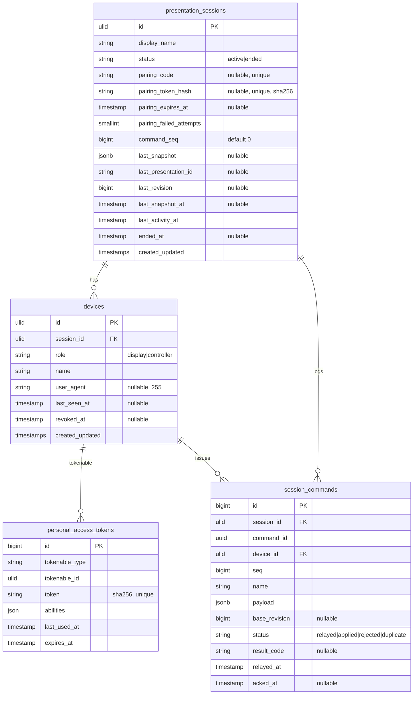

# 03 — Low-Level Design (LLD)

Conventions: PHP 8.4, Laravel 12+ (or the current major at project start), strict types. Front end is TypeScript `strict: true`. Times are **epoch milliseconds (int)** unless the name ends in `Mono` (`performance.now()` ms, float). Durations end in `Ms`.

---

## 1. Repository layout

```
stagecue/
├─ app/
│  ├─ Modules/
│  │  ├─ Sessions/   {Controllers, Services, Models, Requests, Resources}
│  │  ├─ Pairing/    {Controllers, Services, Requests}
│  │  └─ Relay/      {Controllers, Services, Requests, Events, Support/CommandCatalogue.php}
│  ├─ Http/Middleware/{EnsureDeviceAbility.php, EnsureSessionMember.php, AddServerTime.php}
│  └─ Console/Commands/PruneSessions.php
├─ routes/{api.php, channels.php, web.php, console.php}
├─ database/migrations/
├─ resources/
│  ├─ views/app.blade.php                 # SPA shell
│  └─ js/
│     ├─ main.ts  router.ts  sw.ts
│     ├─ core/        # PURE — no Vue, no DOM, no network
│     │  ├─ types.ts  clock.ts  timer.ts  message.ts  reducer.ts
│     │  ├─ view.ts   format.ts  commands.ts  schemas.ts (zod)
│     ├─ display/     # DisplayRuntime.ts, TickLoop.ts, ClockReconciler.ts, Fullscreen.ts,
│     │               # WakeLock.ts, ScreenPicker.ts, Keyboard.ts, SingleTabLock.ts, SnapshotPublisher.ts
│     ├─ control/     # ControllerRuntime.ts, CommandOutbox.ts, MirrorClock.ts, PreviewModel.ts
│     ├─ transport/   # ApiClient.ts, RealtimeClient.ts, Heartbeat.ts, ConnectionStateMachine.ts, ServerClock.ts
│     ├─ storage/     # db.ts, PresentationRepo.ts, ProcessedCommandRepo.ts, DeviceRepo.ts, DraftRepo.ts, MetaRepo.ts
│     ├─ stores/      # display.ts, control.ts, connection.ts (Pinia)
│     ├─ views/       # HomeView, DisplayView, ControlView, PairView, NotFoundView
│     ├─ components/
│     │  ├─ stage/    # Stage.vue, StageTimer.vue, StageMessage.vue, StageOvertime.vue, StageBlack.vue, FitText.vue
│     │  ├─ display/  # SetupPanel.vue, PairingCard.vue, ConnectToTvGuide.vue, FullscreenHint.vue
│     │  ├─ control/  # TimerPanel.vue, DurationPicker.vue, MessageComposer.vue, CornerPicker.vue,
│     │  │            # MessageDurationPicker.vue, BlackoutZone.vue, LiveMirror.vue, PreviewSheet.vue,
│     │  │            # CommandButton.vue, DraftList.vue
│     │  └─ common/   # ConnectionBadge.vue, InstallPrompt.vue, Toast.vue
│     └─ contracts/fixtures/*.json        # shared by Pest & Vitest
├─ tests/{Feature, Unit}                  # Pest
├─ resources/js/**/__tests__/*.spec.ts    # Vitest
├─ e2e/*.spec.ts                          # Playwright
└─ docs/
```

---

## 2. Database design

The MVP needs four tables (plus Laravel's defaults). There are no users.



**Indexes**
- `presentation_sessions`: unique(`pairing_code`), unique(`pairing_token_hash`), index(`status`, `last_activity_at`).
- `devices`: index(`session_id`, `role`, `revoked_at`).
- `session_commands`: **unique(`session_id`, `command_id`)** (idempotency), index(`session_id`, `seq`), index(`relayed_at`) for pruning.
- `personal_access_tokens`: change `tokenable_id` to `ulid`/string. Use `ulidMorphs` in the published migration.

**Session lifecycle**
```
created(active) ──pair──▶ active (controller attached) ──end/revoke──▶ active (no controller)
     │                                                        │
     └──────── no activity for 7 days / explicit end ─────────▶ ended ──(prune +30d)──▶ deleted
```
- `last_activity_at` is updated by any command, snapshot or heartbeat fallback (throttled to once per 60 s).
- A display token expires 30 days after issue. A controller token expires after 7 days (and is renewed on use, via middleware that extends `expires_at` when it is < 24 h away).
- Pairing secrets: `pairing_code` and `pairing_token_hash` are set to null as soon as they are consumed, or after `pairing_expires_at`.

**Data retention**
- `session_commands` older than 7 days are deleted.
- Sessions with `ended` status for 30 days, or `active` with `last_activity_at` older than 30 days, are deleted (cascading to devices and tokens).
- `last_snapshot` contains message text. It is deleted with the session. No other personal data is stored.

---

## 3. Core domain (front end, pure TS)

### 3.1 Types (`core/types.ts`)
```ts
export type Corner = 'tl' | 'tr' | 'bl' | 'br';

export type TimerState =
  | { status: 'idle' }
  | { status: 'ready';   durationMs: number }                              // never started since SET/RESET
  | { status: 'running'; durationMs: number; endsAtWall: number; startedAtWall: number }
  | { status: 'paused';  durationMs: number; remainingMs: number; pausedAtWall: number; startedAtWall: number } // remainingMs may be < 0 (paused in overtime)
  | { status: 'overtime';durationMs: number; endsAtWall: number; startedAtWall: number };

export type MessageState =
  | { status: 'none' }
  | { status: 'showing'; id: string; text: string; mode: 'timed' | 'persistent';
      durationMs: number | null; shownAtWall: number; expiresAtWall: number | null; corner: Corner };

export interface Settings { defaultCorner: Corner; overtimeInterruptsMessage: boolean; defaultMessageDurationMs: number; }

export interface PresentationState {
  schema: 1; presentationId: string; revision: number;
  display: { blackout: boolean };
  timer: TimerState; message: MessageState; settings: Settings;
  updatedAtWall: number;
}

export type CommandName =
  | 'TIMER_SET' | 'TIMER_START' | 'TIMER_PAUSE' | 'TIMER_RESUME' | 'TIMER_RESET' | 'TIMER_CLEAR'
  | 'MESSAGE_SHOW' | 'MESSAGE_DISMISS' | 'BLACKOUT_ON' | 'BLACKOUT_OFF'
  | 'SETTINGS_UPDATE' | 'PRESENTATION_NEW' | 'SYNC_REQUEST';
export type InternalEvent = 'TIMER_EXPIRED' | 'MESSAGE_EXPIRED';

export type Action =
  | { kind: 'command'; name: CommandName; payload: unknown; commandId: string; baseRevision: number | null }
  | { kind: 'internal'; name: InternalEvent };

export type ApplyResult =
  | { ok: true; state: PresentationState; events: DomainEvent[]; changed: boolean }
  | { ok: false; code: RejectCode; message: string };

export type RejectCode = 'INVALID_STATE' | 'INVALID_PAYLOAD' | 'STALE' | 'STALE_VIEW' | 'DUPLICATE' | 'UNKNOWN_COMMAND';
export type DomainEvent = 'TimerSet'|'TimerStarted'|'TimerPaused'|'TimerResumed'|'TimerReset'|'TimerCleared'
  |'TimerExpired'|'OvertimeStarted'|'MessageShown'|'MessageReplaced'|'MessageDismissed'|'MessageExpired'
  |'BlackoutOn'|'BlackoutOff'|'SettingsUpdated'|'PresentationStarted';
```

### 3.2 Clock (`core/clock.ts`)
```ts
export interface Clock { wallNow(): number; monoNow(): number; }
export const systemClock: Clock = { wallNow: () => Date.now(), monoNow: () => performance.now() };
export class FakeClock implements Clock { /* advance(ms), jumpWall(ms), suspend(ms) for tests */ }
```
The reducer takes `now: number` (an **effective wall time** supplied by the runtime, see §5.2). It never reads a clock itself.

### 3.3 Reducer (`core/reducer.ts`) — full transition table

| Action | Pre-condition (timer) | Result |
|---|---|---|
| `TIMER_SET {durationMs}` | any | timer = `ready(durationMs)`. *Destructive.* |
| `TIMER_START` | `ready` | `running{endsAtWall: now+durationMs, startedAtWall: now}` |
| `TIMER_PAUSE` | `running` \| `overtime` | `paused{remainingMs: endsAtWall-now, pausedAtWall: now}` |
| `TIMER_RESUME` | `paused` | if remainingMs > 0 → `running{endsAtWall: now+remainingMs}`, else `overtime{endsAtWall: now+remainingMs}` |
| `TIMER_RESET` | not `idle` | `ready(durationMs)`. *Destructive.* |
| `TIMER_CLEAR` | any | `idle`. *Destructive.* |
| `TIMER_EXPIRED` (internal) | `running` and `now ≥ endsAtWall` | `overtime{same endsAtWall}`. If `settings.overtimeInterruptsMessage` and a message is showing → message = `none` too |
| `MESSAGE_SHOW {id,text,mode,durationMs?,corner?}` | any | message = showing (`expiresAtWall = mode==='timed' ? now+durationMs : null`, `corner = payload.corner ?? settings.defaultCorner`). Event `MessageReplaced` if a message was already showing, otherwise `MessageShown` |
| `MESSAGE_DISMISS {id?}` | message showing (and id matches if given) | message = `none`. If no message is showing, or the id does not match → `ok` with `changed:false` (idempotent no-op) |
| `MESSAGE_EXPIRED` (internal) | showing, timed, `now ≥ expiresAtWall` | message = `none` |
| `BLACKOUT_ON` / `BLACKOUT_OFF` | any | `display.blackout = true/false`. No-op if it is already set |
| `SETTINGS_UPDATE {partial}` | any | merge the validated settings |
| `PRESENTATION_NEW` | any | a fresh state with a new `presentationId`, revision 0, settings kept. *Destructive.* |
| `SYNC_REQUEST` | any | no state change, `changed:false`. The runtime publishes a snapshot |

After any `changed:true` result: `revision += 1`, `updatedAtWall = now`.

```ts
export function apply(s: PresentationState, a: Action, now: number): ApplyResult {
  const v = validatePayload(a);            // zod; returns INVALID_PAYLOAD on failure
  if (!v.ok) return v;
  if (a.kind === 'command' && DESTRUCTIVE.has(a.name) && a.baseRevision !== null && a.baseRevision < s.revision)
    return reject('STALE_VIEW');
  switch (a.name) { /* per table above; illegal pre-condition → reject('INVALID_STATE') */ }
}
```
`DESTRUCTIVE = {TIMER_SET, TIMER_RESET, TIMER_CLEAR, PRESENTATION_NEW}`. A `baseRevision` of `null` is allowed **only** for local keyboard actions on the Display.

### 3.4 View derivation (`core/view.ts`)
```ts
export type View =
 | { kind: 'black' }
 | { kind: 'standby' }
 | { kind: 'timer'; text: string; paused: boolean; overtime: false }
 | { kind: 'overtime'; text: string /* +HH:MM:SS */; paused: boolean }
 | { kind: 'message'; message: {text; corner}; compact: null | { text: string; overtime: boolean } };

export function deriveView(s, now): View {
  if (s.display.blackout) return { kind: 'black' };
  const t = timerReadout(s.timer, now);      // {remainingMs, overtimeMs, text, overtime, paused} | null
  if (s.message.status === 'showing') return { kind: 'message', message: …, compact: t && { text: t.text, overtime: t.overtime } };
  if (!t) return { kind: 'standby' };
  return t.overtime ? { kind: 'overtime', text: t.text, paused: t.paused } : { kind: 'timer', text: t.text, paused: t.paused };
}
```

### 3.5 Formatting (`core/format.ts`)
- Countdown display: `ceil(remainingMs/1000)` seconds, so `15:00` is shown for the whole first second and `00:00` never appears while still running. `H:MM:SS` if ≥ 3600 s, otherwise `MM:SS`.
- Overtime: `floor(overtimeMs/1000)`, formatted `+HH:MM:SS`. Overtime starts at `+00:00:00` and reaches `+00:00:01` 1 s after expiry.

---

## 4. Front-end design

### 4.1 Routes (`router.ts`)
| Path | View | Guard |
|---|---|---|
| `/` | HomeView | — |
| `/display` | DisplayView | acquires SingleTabLock. Fails → "Already open" screen |
| `/pair` | PairView | reads `location.hash` `t=` param, then strips it (`history.replaceState`) |
| `/control` | ControlView | needs a controller credential in DeviceRepo, otherwise redirect to `/pair` |
| `/:pathMatch(.*)*` | NotFoundView | — |

Laravel `routes/web.php`: `Route::view('/{any?}', 'app')->where('any', '^(?!api|broadcasting|sw\.js|build).*$')`, and `GET /__shell` returns the same view (this is the cache key for offline navigation).

### 4.2 Pinia stores
| Store | State (readonly to components) | Actions (delegate to the runtime) |
|---|---|---|
| `display` | `state: PresentationState`, `view: View`, `fullscreen`, `wakeLock`, `pairing{code, qrUrl, expiresAt}`, `controller{name, connected}` | `localCommand(name, payload)`, `regenerateCode()`, `revokeController()`, `enterFullscreen(screen?)` |
| `control` | `mirror: {state, receivedAtMono, remainingMsAtReceipt}`, `outbox: PendingCommand[]`, `drafts`, `form{h,m,s, text, mode, durationMs, corner}` | `send(name, payload)`, `retry(commandId)`, `saveDraft()`, `sendDraft(id)`, `unpair()` |
| `connection` | `server: 'online'\|'offline'`, `peer: 'connected'\|'reconnecting'\|'synchronizing'\|'disconnected'`, `lastPeerHeartbeatAt`, `socketState` | — |

### 4.3 DisplayRuntime (`display/DisplayRuntime.ts`)
Responsibilities: boot → hydrate → tick → receive commands → apply → persist → render → publish.
```ts
class DisplayRuntime {
  constructor(deps: { clock: Clock; repo: PresentationRepo; processed: ProcessedCommandRepo; device: DeviceRepo;
                      api: ApiClient; rt: RealtimeClient; publisher: SnapshotPublisher; reconciler: ClockReconciler; onState(s, view) });
  async boot(): Promise<void>;          // §5.5
  handleRemote(cmd: CommandEnvelope);   // §6.2
  local(name, payload);                 // keyboard; baseRevision=null; commandId=uuidv7()
  private commit(result, action);       // persist (single tx) → emit → publish
  private tick();                       // TickLoop callback, §5.3
}
```
Everything is serialised through one **async mutex** (`commitQueue`), so a remote command and an internal expiry can never interleave mid-write.

### 4.4 Stage rendering & animation
`Stage.vue` props: `view: View`, `mode: 'live'|'preview'`. It is the **same component** in the Display and in PreviewSheet.

Layout:
```html
<div class="stage" :data-kind="view.kind">              <!-- position:relative; width/height 100%; overflow hidden; container-type: size -->
  <StageBlack v-if="black" />                            <!-- absolute inset-0 bg-black z-50, cursor:none -->
  <StageMessage :message />                              <!-- <Transition name="msg"> fade+rise 300ms; FitText inside safe area minus the corner timer box -->
  <StageTimer :text :compact :corner :overtime :paused /> <!-- ALWAYS mounted while the timer is not idle -->
  <StageOvertime v-if="overtime-fullscreen" />           <!-- red bg, TIME UP! + counter; <Transition> crossfade 400ms -->
</div>
```
Timer movement (FR-R2/R3/R4). Transform only, no layout reflow:
- The timer element is `position:absolute; left:50%; top:50%; transform-origin:center`. Its size comes from `font-size: 22cqh` (container query units, so Preview scales the same way).
- Target transforms are computed in JS from the stage size `W×H` and the timer's natural box `w×h` (measured once with a `ResizeObserver`):
  - centre: `translate(-50%,-50%) scale(1)`
  - compact scale `k = 0.28`. Margin `m = 0.04·min(W,H)`.
  - `tl`: `translate(calc(-W/2 + m), calc(-H/2 + m)) translate(0,0) scale(k)` with transform-origin top left. To avoid switching the origin mid-animation, convert to centre-origin math: `dx = -(W/2) + m + k·w/2`, `dy = -(H/2) + m + k·h/2` → `translate(-50%,-50%) translate(dx px, dy px) scale(k)`. `tr`/`bl`/`br` mirror the signs.
- The result is applied as a CSS variable `--timer-transform`, with `transition: transform 500ms cubic-bezier(.2,.8,.2,1)`. Changing corners just changes the variable, so the transition from the current position is smooth and nothing re-mounts.
- `will-change: transform` only while transitioning (it is toggled by `transitionstart`/`transitionend`).
- Digits: `font-variant-numeric: tabular-nums; font-feature-settings: "tnum"`. Font: self-hosted Inter (or a similar typeface) with tabular figures, precached.
- `prefers-reduced-motion` → duration 0 ms.
- Overtime colour: the `--stage-bg` variable transitions 400 ms to `#C8102E`. The compact timer in overtime uses a red pill background.

`FitText.vue`: binary search on `font-size` (8 iterations, 2vh–40vh range) until `scrollHeight ≤ clientHeight && scrollWidth ≤ clientWidth`. It re-runs on text change and on resize, and it is debounced with rAF.

### 4.5 Display chrome
- **SetupPanel** (visible only when `!document.fullscreenElement`): pairing card (QR from `qrcode` + a large code + expiry countdown + Regenerate), controller status + Revoke, Present on screen…, Connect-to-TV guide, local controls cheat-sheet, a storage persistence warning, and "New presentation". It overlays the stage at 30% width on the right and does not hide the stage.
- **Fullscreen.ts**: `enter(screen?)` → `document.documentElement.requestFullscreen({ navigationUI: 'hide', screen })`. Listens to `fullscreenchange`. Hides the cursor after 2 s of no movement.
- **ScreenPicker.ts**: if `'getScreenDetails' in window` → `await getScreenDetails()` → list `screens` (label, resolution, `isPrimary`). Selecting a screen fullscreens onto it. Otherwise it is hidden.
- **WakeLock.ts**: `navigator.wakeLock.request('screen')`, re-requested on `visibilitychange` → visible, released on unmount.
- **Keyboard.ts**: `F` toggle fullscreen · `B` toggle blackout · `Space` start/pause/resume · `R` reset (requires double press within 1 s) · `D` dismiss message · `Esc` (native exit). Input focus guard.
- **SingleTabLock.ts**: `navigator.locks.request('stagecue-display', { ifAvailable: true }, lock => lock ? holdForever() : reportBusy())`.
- **FullscreenHint.vue**: after boot, if not fullscreen → a corner chip "Press F for fullscreen" for 4 s.

### 4.6 Controller UI (ControlView)
Top bar: `ConnectionBadge` (Server + Display) · session name · menu (Unpair).
Sections (a single scroll column, sticky bottom action bar):
1. **LiveMirror**: a small `Stage` fed by the mirror state + `MirrorClock`, labelled "LIVE". It shows `Black screen active` prominently when blackout is on.
2. **TimerPanel**: DurationPicker (H/M/S steppers + chips 5/10/15/20/30). Buttons (each one a `CommandButton` with pending/confirmed/failed states). Disabled states follow the timer state:
   - idle → [Display Timer] [Display & Start]
   - ready → [Start] [Display Timer (update)] [Clear]
   - running/overtime → [Pause] [Reset] [Clear]
   - paused → [Resume] [Reset] [Clear]
3. **MessageComposer**: textarea (500 characters, counter), MessageDurationPicker (5/10/15/30/60/Custom/Until dismissed), CornerPicker (a 2×2 mini-screen), [Preview] [Send Live], [Clear Message].
4. **BlackoutZone**: a red-bordered card at the bottom. [Hold for Black Screen] (600 ms hold with a progress ring). When blackout is active, the whole sticky action bar becomes a large white **Restore Display** button.
5. **DraftList**: drafts saved while the Display was unreachable, each with "Send now" and "Discard".

`CommandButton` lifecycle: `idle → sending (POST in flight) → awaiting-ack → confirmed (800 ms check) → idle`, or `→ rejected (shows reason)`, or `→ unconfirmed (after 3 s) [Retry]`.

### 4.7 MirrorClock (Controller)
On a snapshot: store `remainingMsAtReceipt = snapshot.computed.timerRemainingMs`, `messageRemainingMs`, `receivedAtMono = performance.now()`. Rendering: `remaining = remainingMsAtReceipt - (monoNow - receivedAtMono)` while `running`/`overtime`, otherwise frozen. It never uses the Display's wall timestamps.

### 4.8 PreviewModel
`preview = apply(clone(mirror.stateAt(nowEff)), draftCommand, nowEff)`, then `deriveView(preview, nowEff)`. The "Preview as overtime" toggle substitutes `timer = overtime(endsAtWall = now - 5000)`. It is rendered in `PreviewSheet` (bottom sheet, 16:9 frame). Only a local reducer is used. There are no network calls.

### 4.9 IndexedDB repositories (`storage/`)
```ts
// db.ts
openDB('stagecue', 1, { upgrade(db) {
  db.createObjectStore('presentation');                     // key 'current'
  const pc = db.createObjectStore('processedCommands', { keyPath: 'commandId' });
  pc.createIndex('appliedAt', 'appliedAt');
  db.createObjectStore('device');                           // key 'self'
  db.createObjectStore('drafts', { keyPath: 'id' });
  db.createObjectStore('meta');                             // key/value
}});
```
- `PresentationRepo.load(): Promise<PresentationState|null>` (validates with zod. On a schema mismatch it moves the record to `meta['corrupt-<ts>']` and returns null).
- `PresentationRepo.commit(state, processed?: ProcessedRecord)`: **one** transaction over `presentation` and `processedCommands`. After commit, trim `processedCommands` to 500 by the `appliedAt` index.
- Write failures (quota, private mode): keep running in memory and surface the "State not saved" warning in SetupPanel only (never on the stage).

### 4.10 PWA configuration
`vite.config.ts`:
```ts
VitePWA({
  strategies: 'injectManifest', srcDir: 'resources/js', filename: 'sw.ts',
  outDir: 'public/build', base: '/', scope: '/', injectRegister: null,  // registered manually from main.ts with scope '/'
  manifest: {
    name: 'StageCue', short_name: 'StageCue', start_url: '/', scope: '/', display: 'standalone',
    display_override: ['window-controls-overlay', 'standalone'], background_color: '#000000', theme_color: '#000000',
    icons: [192, 512, 'maskable-512'] /* PNGs in public/icons */,
    shortcuts: [{ name: 'Display', url: '/display' }, { name: 'Controller', url: '/control' }]
  },
  injectManifest: { globPatterns: ['**/*.{js,css,woff2,png,svg,webmanifest}'] }
})
```
- The SW is served at `/sw.js` by a Laravel route that reads `public/build/sw.js` with the headers `Content-Type: text/javascript`, `Cache-Control: no-cache` and `Service-Worker-Allowed: /`.
- `sw.ts`: `precacheAndRoute(self.__WB_MANIFEST)`. On `install`, cache `/__shell` in the `shell-v<build>` cache. Navigation route: `NetworkFirst({ networkTimeoutSeconds: 3 })`, falling back to the cached `/__shell`. `/api/*` and `/broadcasting/*` are **NetworkOnly**. Update flow: a new SW waits. The Display **never** auto-reloads while a timer is running or a message is showing. The SetupPanel shows "Update available — apply". The Controller applies it when idle.
- The Manifest `<link>` and the theme-color meta go in `app.blade.php`.

---

## 5. Timer & message algorithms

### 5.1 Effective time
The runtime computes `nowEff` (effective wall time) and passes it to `apply`/`deriveView`:
```
nowEff = anchorWall + (clock.monoNow() - anchorMono)
```
`anchorWall`/`anchorMono` are set at boot (`anchorWall = Date.now()`, `anchorMono = performance.now()`) and adjusted only by the ClockReconciler. All persisted timestamps (`endsAtWall`, `expiresAtWall`, …) live in the same "effective wall" timeline.

### 5.2 Clock reconciliation (`display/ClockReconciler.ts`)
This runs on every tick and on `visibilitychange`, `pageshow`, `focus` and `online`.
```
sample():
  mono = monoNow(); wall = wallNow()
  dMono = mono - lastMono;  dWall = wall - lastWall          // since previous sample
  drift = (wall - (anchorWall + (mono - anchorMono)))        // wall vs effective
  if |drift| < 1500ms: (normal) slowly slew: anchorWall += drift * 0.1   // keeps NTP corrections in
  else if dMono > 2000 and dWall > dMono + 1000:
      // We were SUSPENDED (sleep / frozen tab) and the monotonic clock did not advance through the sleep.
      // Trust the WALL clock: real time passed.
      anchorWall = wall; anchorMono = mono                    // nowEff jumps forward to real time
  else:
      // Ticks were regular but the wall clock jumped → a manual/system CLOCK CHANGE.
      // Trust MONO: keep nowEff continuous, and rebase all persisted wall timestamps by `drift`.
      shiftAllWallTimestamps(state, +drift); anchorWall += drift; commit(state)  // revision++ with event 'ClockAdjusted'
  lastMono = mono; lastWall = wall
```
Documented rules (they appear in the Test Plan as UNIT-CLK-*):
1. Normal operation: wall ≈ mono. Small NTP slews are absorbed.
2. Device sleep or a frozen tab: real elapsed time is honoured (a timer that should have expired shows overtime).
3. A system clock change while the page is running: the presentation is unaffected (a 15-minute talk stays 15 minutes).
4. A clock change while the page was **closed**: it cannot be detected. The state follows the new wall clock. This is a limitation.
5. Combined sleep + clock change: it is treated as sleep (rule 2). This is a limitation.

### 5.3 Tick loop (`display/TickLoop.ts`)
```
schedule(): delay = 1000 - (nowEff % 1000) + 5     // align to second boundaries
            setTimeout(tick, delay)                 // (+ rAF for the actual paint)
tick():
  reconciler.sample()
  n = nowEff
  if timer.status=='running' && n >= timer.endsAtWall: runtime.internal('TIMER_EXPIRED')
  if message.status=='showing' && message.expiresAtWall && n >= message.expiresAtWall: runtime.internal('MESSAGE_EXPIRED')
  displayStore.now = n            // single reactive write → digits recompute
  schedule()
```
Also call `tick()` immediately on `visibilitychange`→visible. A watchdog uses `requestAnimationFrame`: if no tick happened in 3 s while visible, re-schedule.

### 5.4 Pause / resume / overtime (worked example)
```
SET 900000            → ready{900000}                 display 15:00
START at t0           → running{endsAt=t0+900000}
PAUSE at t0+60000     → paused{remaining=840000}      display 14:00 (frozen)
RESUME at t1          → running{endsAt=t1+840000}
tick at n ≥ endsAt    → TIMER_EXPIRED → overtime{endsAt}  display +HH:MM:SS of (n-endsAt)
PAUSE in overtime at p → paused{remaining = endsAt - p  (negative)}   display TIME UP +00:00:12 (frozen)
RESUME at q           → overtime{endsAt = q + remaining}
RESET                 → ready{900000}
```

### 5.5 Reload / restart recovery (`DisplayRuntime.boot`)
```
boot():
  acquire SingleTabLock (or show "already open")
  anchorWall = Date.now(); anchorMono = performance.now()
  state = await repo.load() ?? freshState()
  n = nowEff
  // Catch up on internal transitions that happened while closed, in time order:
  events = []
  if state.timer.status=='running' && n >= endsAt:  events.push({at: endsAt, a:'TIMER_EXPIRED'})
  if state.message timed && n >= expiresAt:         events.push({at: expiresAt, a:'MESSAGE_EXPIRED'})
  for e in sortBy(events,'at'): state = apply(state, internal(e.a), e.at).state   // apply at the historical time
  await repo.commit(state)
  render immediately (blackout restored if it was on)
  start TickLoop
  device = await deviceRepo.get()
  if online: connect (resume the session with the stored token; if 401/404 → create a new session, keep the local state)
  publisher.publishNow()
  request storage.persist(); request wakeLock; show FullscreenHint
```
Applying catch-up events at their **historical** time keeps rule A2 deterministic. For example, if the message expired before the timer did, the result is the full overtime screen.

### 5.6 Message expiry and dismissal
- Expiry: tick-driven (§5.3). It is idempotent: `MESSAGE_EXPIRED` is ignored if `n < expiresAt` or if the status is not `showing`.
- Manual dismissal: `MESSAGE_DISMISS {id?}`. Including `id` prevents a late dismiss from removing a *newer* message (race: the operator dismisses A while B is in flight).
- Replacement: `MESSAGE_SHOW` always overwrites. `expiresAt` is recomputed from the new `durationMs`.

### 5.7 Blackout
`display.blackout` is only a flag. The tick loop, expiry and overtime all run unchanged. `deriveView` returns `black` first. When blackout is turned off, the next render calls `deriveView(state, nowEff)`, so it shows whatever is correct now. Loss of connection never changes `blackout`.

---

## 6. Offline & synchronisation implementation

### 6.1 Command envelope (Controller → server → Display)
See 04-API-and-Events §3 for the JSON. The Controller builds it with `commandId = uuidv7()` and `baseRevision = mirror.state.revision` (or `null` if there is no mirror). Destructive commands are disabled when there is no mirror.

### 6.2 Display command intake (`handleRemote`)
```
handleRemote(env):
  if !schema.safeParse(env): ack(env, 'INVALID_PAYLOAD'); return
  if env.sessionId != device.sessionId: return                 // ignore silently
  if await processed.has(env.commandId):                        // DUPLICATE
      ack(env, processed.get(...).result, duplicate=true); return
  serverNow = serverClock.now()                                 // §6.5
  if serverNow && serverNow - env.relayedAt > 10_000: ack(env,'STALE'); remember(env,'STALE'); return
  await commitQueue.run(async () => {
     r = apply(state, toAction(env), nowEff)
     if !r.ok: await processed.put(env.commandId, r.code); ack(env, r.code); return
     state = r.state
     await repo.commit(state, {commandId, appliedAt, result:'APPLIED'})   // single tx
     render(); publisher.publishNow({ack: {commandId, result:'APPLIED', seq}})
  })
```
Rejected and stale results are also recorded, so that a retry gets the same answer.

### 6.3 SnapshotPublisher
- `publishNow(ack?)`: builds a snapshot `{presentationId, revision, capturedAtWall, state, computed:{timerRemainingMs, overtimeMs, messageRemainingMs}, ack?}` and POSTs it to `/snapshots`.
- Coalescing: at most one request in flight. If more publishes are requested meanwhile, keep only the latest (but keep **all pending acks** in an array on the next request).
- Periodic re-publish every 30 s (drift correction + liveness for the cached state).
- Failure: exponential back-off 1, 2, 4 … 15 s, latest-wins. On `online`/socket reconnect → flush immediately.

### 6.4 Heartbeat & connection state machine
**Heartbeat (primary, using whispers).** Every 3 s each side sends `presenceChannel.whisper('heartbeat', {role, deviceId, revision, presentationId, sentAt})`. The peer records `lastPeerHeartbeatMono = performance.now()`.

**Fallback (if T0.3 shows that whispers are unsupported).** `POST /api/sessions/{sid}/heartbeat {revision}` every 5 s. The server broadcasts `peer.heartbeat` to the other party's channel. The threshold becomes 15 s. Only `Heartbeat.ts` and its configuration change.

**ConnectionStateMachine** (one per client). Inputs: `navigator.onLine`, the pusher connection state (`connected|connecting|unavailable|failed|disconnected`), the peer heartbeat age, and `syncPending`.
```
server = (navigator.onLine && socket=='connected') ? 'online' : 'offline'
peer =
  socket != 'connected'                  → (lastPeerSeenAge < 30s ? 'reconnecting' : 'disconnected')
  socket == 'connected' && syncPending   → 'synchronizing'
  peerHeartbeatAge ≤ 9s                  → 'connected'
  9s < peerHeartbeatAge ≤ 30s            → 'reconnecting'
  else                                   → 'disconnected'
```
On the Display these appear only in the SetupPanel, so the audience never sees them. On the Controller they are always visible.

**Reconnection.** pusher-js reconnects on its own. In addition, on `online`, `visibilitychange→visible` or `pageshow`, call `rt.reconnect()` if the socket is not connected. A custom back-off of 1, 2, 4, 8, 15 s (max) with ±20% jitter applies to the API retries. Echo re-subscribes to the channels automatically. Each channel's `pusher:subscription_succeeded` triggers the sync handshake.

### 6.5 ServerClock
Every API response carries the header `X-Server-Time: <epoch ms>` (from the `AddServerTime` middleware). `offset = serverTime - (sendWall + rtt/2)`. The client keeps the sample with the smallest RTT from the last 5 and persists it in `meta`. It is used **only** for the staleness check. If it is unknown, the check is skipped.

### 6.6 Controller sync & conflict rules
1. On subscription success → `syncPending = true` → `GET /state` (paint the cached snapshot, labelled "last known") → `POST /commands {SYNC_REQUEST}`.
2. On a `state` event: accept it only if `presentationId` differs (a new epoch, accepted as authoritative) or `revision > mirror.revision`. Equal revisions refresh the `computed` timing only.
3. `syncPending = false` when the first fresh snapshot arrives after subscription (its `capturedAtWall` is newer than the time of the subscription, using an ack match of the SYNC_REQUEST `commandId`).
4. The Controller **never** sends state. A revision regression is ignored and logged.
5. Pending outbox entries are invalidated on reconnect: anything still `awaiting-ack` from before the disconnect turns into `unconfirmed`, and the operator chooses Retry (same `commandId`) or Discard.
6. Drafts are only sent by an explicit "Send now", which creates a **new** `commandId` and uses the current `baseRevision`.

### 6.7 Duplicate & stale protection summary
| Layer | Mechanism |
|---|---|
| Server | Unique (`session_id`, `command_id`). A repeat POST returns `200 {duplicate:true, seq, status}` and **re-broadcasts only if it is not yet acked** (this covers a Display that missed it). |
| Display | The persisted `processedCommands` set. The same answer is returned for repeats. |
| Display | The 10 s staleness window using `relayedAt`. |
| Display | `STALE_VIEW` for destructive commands with an outdated `baseRevision`. |
| Controller | It only accepts snapshots with a higher revision within the same `presentationId`. |
| Controller | No automatic replay. Retry keeps the `commandId`. |

---

## 7. Back-end design

### 7.1 Models
- `PresentationSession` (HasUlids). Relations: `devices()`, `displayDevice()`, `activeController()`, `commands()`. Casts: `last_snapshot` → array, timestamps.
- `Device` (HasUlids, HasApiTokens). `isDisplay()`, `isController()`, `scopeActive()`.
- `SessionCommand`.

### 7.2 Services
| Service | Methods |
|---|---|
| `SessionService` | `create(displayName, userAgent): CreatedSession` (session + display device + token with ability `display`, expiring in 30 d + pairing). `resume(Device): PresentationSession`. `end(session)`. `touch(session)`. |
| `PairingService` | `issue(session): PairingSecrets` (code + token, hash stored, expiry 10 min). `consume(code\|token, deviceName, ua): PairResult` (inside `DB::transaction` with `lockForUpdate`: validate → null the secrets → revoke existing controllers and delete their tokens → create a device + token with ability `controller` → broadcast `ControllerPaired` + `ControllerRevoked`). `revokeController(session)`. `recordFailure(session)`. |
| `RelayService` | `relayCommand(Device, session, CommandData): RelayResult`. In a transaction: insert `session_commands`, catching the unique violation → duplicate path. `seq` = `UPDATE … SET command_seq = command_seq + 1 RETURNING command_seq`. Then `broadcast(new CommandRelayed(...))` **after commit**. `acceptSnapshot(Device, session, SnapshotData)`: store `last_snapshot` if `(presentationId differs) or revision ≥ last_revision`. Mark the acked commands `applied/rejected`. Broadcast `StateUpdated`. |

### 7.3 Controllers & routes (`routes/api.php`)
```php
Route::middleware(['throttle:session-create'])->post('/sessions', [SessionController::class, 'store']);
Route::middleware(['throttle:pairing'])->post('/pairings', [PairingController::class, 'store']);
Route::get('/time', TimeController::class);                         // {serverTime}

Route::middleware(['auth:sanctum', 'session.member'])->prefix('/sessions/{session}')->group(function () {
    Route::get('/', [SessionController::class, 'show']);             // both roles
    Route::get('/state', [SnapshotController::class, 'show']);       // both roles
    Route::delete('/', [SessionController::class, 'destroy'])->middleware('ability:display');
    Route::post('/pairing/regenerate', [PairingController::class, 'regenerate'])->middleware('ability:display');
    Route::delete('/controller', [PairingController::class, 'revoke'])->middleware('ability:display');
    Route::delete('/controller/self', [PairingController::class, 'leave'])->middleware('ability:controller');
    Route::post('/commands', [CommandController::class, 'store'])->middleware(['ability:controller', 'throttle:commands']);
    Route::post('/snapshots', [SnapshotController::class, 'store'])->middleware(['ability:display', 'throttle:snapshots']);
    Route::post('/heartbeat', HeartbeatController::class)->middleware('throttle:heartbeat');   // fallback only
});
Broadcast::routes(['prefix' => 'api', 'middleware' => ['auth:sanctum']]);   // POST /api/broadcasting/auth
```
- `session.member` middleware: `$request->user()` is a `Device` with `session_id == {session}` and `revoked_at null`, otherwise `403 NOT_SESSION_MEMBER`. Ended session → `410 SESSION_ENDED`.
- Rate limiters (`AppServiceProvider`): `session-create` 10/min/IP · `pairing` 5/min/IP + 20/hour/IP · `commands` 60/min/device · `snapshots` 120/min/device · `heartbeat` 30/min/device.

### 7.4 Validation (FormRequests)
- `CreateSessionRequest`: `displayName` string 1–60 (default "Display").
- `PairRequest`: `code` regex `/^[2-9A-HJKMNP-Z]{6}$/i` **xor** `token` string 43 (base64url of 32 bytes). `deviceName` 1–60.
- `CommandRequest`: `v` in:1 · `commandId` uuid · `name` in the catalogue · `baseRevision` int ≥ 0 nullable · `issuedAt` int · `payload` validated per name by `CommandCatalogue::rules($name)`:
  - `TIMER_SET`: `durationMs` int 1000–86_399_000
  - `MESSAGE_SHOW`: `id` uuid, `text` string 1–500 (trimmed, not blank), `mode` in timed,persistent, `durationMs` required_if timed, int 1000–600000, `corner` nullable in tl,tr,bl,br
  - `MESSAGE_DISMISS`: `id` nullable uuid
  - `SETTINGS_UPDATE`: `defaultCorner`, `overtimeInterruptsMessage` bool, `defaultMessageDurationMs`, all optional
  - the rest: payload must be empty `{}`
- `SnapshotRequest`: `presentationId` ulid · `revision` int · `capturedAtWall` int · `state` array (max 16 KB JSON) · `computed` · `acks` array ≤ 50 of `{commandId, result, code?}`.

The server validates **shape**, not presentation semantics. Semantics belong to the Display reducer.

### 7.5 Broadcast events (all `ShouldBroadcastNow`, `broadcastAs` short names)
| Class | Channel | `broadcastAs` | Payload |
|---|---|---|---|
| `CommandRelayed` | `private-session.{sid}.display` | `command` | the command envelope (04 §3.1) |
| `StateUpdated` | `private-session.{sid}.controllers` | `state` | the snapshot + acks (04 §3.2) |
| `ControllerPaired` | `...display` | `controller.paired` | `{deviceId, name, pairedAt}` |
| `ControllerRevoked` | `...display` and `...controllers` | `controller.revoked` | `{deviceId, reason}` |
| `SessionEnded` | both private channels | `session.ended` | `{endedAt}` |
| `PeerHeartbeat` (fallback) | the other party's channel | `peer.heartbeat` | `{role, revision, sentAt}` |

### 7.6 Channel authorisation (`routes/channels.php`)
```php
Broadcast::channel('session.{sid}.display', fn (Device $d, string $sid) => $d->session_id === $sid && $d->isDisplay() && !$d->revoked_at);
Broadcast::channel('session.{sid}.controllers', fn (Device $d, string $sid) => $d->session_id === $sid && !$d->revoked_at);
Broadcast::channel('session.{sid}', fn (Device $d, string $sid) =>   // presence
    $d->session_id === $sid && !$d->revoked_at ? ['id' => $d->id, 'role' => $d->role, 'name' => $d->name] : false);
```
`config/broadcasting.php`: guard `sanctum` for broadcast auth. Reverb app setting: client events accepted from members only (see T0.3).

### 7.7 Error handling
- One JSON error shape: `{ "error": { "code": "PAIRING_EXPIRED", "message": "…", "retryable": false } }`, rendered by `bootstrap/app.php` `withExceptions` for `api/*`.
- Broadcast failures inside `RelayService` (Reverb unreachable) → `503 RELAY_UNAVAILABLE {retryable:true}`. The command row is kept as `relayed=false`, and a retry re-broadcasts it.
- All exceptions go to the log (stack `stderr` on Cloud) with the `session_id` and `command_id` in context. Message text is never logged.

### 7.8 Console
- `sessions:prune` (daily 03:00 UTC): the retention rules from §2.
- `pairing:expire` (every 5 minutes): set expired codes and tokens to null.
